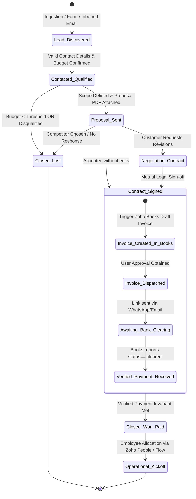

# 🧠 Business Process Flow Logic & State Machine Reference

This document formalizes the business logic, state machines, branching criteria, validation gates, and error recovery policies for Bigin-orchestrated workflows.

---

## 1. Pipeline State Machine Logic

Every business operation in Bigin behaves as a state machine where deals/cards transition through discrete states governed by transition guards:



---

## 2. Transition Guards & Validation Logic

A state transition must not occur unless all transition guards evaluate to `TRUE`:

| State Transition | Guard Condition (Validation Rules) | On Failure Action |
| :--- | :--- | :--- |
| **`Discovered` $\rightarrow$ `Qualified`** | `Email` is valid format AND `Phone` is populated AND `Estimated_Budget > 0` | Flag missing fields in Bigin Notes; keep in `Discovered`. |
| **`Qualified` $\rightarrow$ `Proposal Sent`** | `Proposal_URL` != null AND `Quoted_Amount == Deal_Amount` | Halt transition; alert deal owner to attach proposal. |
| **`Proposal Sent` $\rightarrow$ `Contract Signed`** | `Signed_Agreement_URL` != null OR `eSign_Status == 'COMPLETED'` | Reject transition; request signed document. |
| **`Contract Signed` $\rightarrow$ `Closed Won`** | **MANDATORY**: `ZohoBooks_Payment_Status == 'cleared'` AND `Amount_Received >= Invoice_Amount` | **Strict Rejection**: Do NOT mark Won; emit payment overdue reminder. |

---

## 3. Branching Decision Trees

```text
Decision Node: Inbound Business Inquiry
  ├── Check: Is Contact from Existing Customer?
  │     ├── YES:
  │     │    ├── Check: Does Customer have open Overdue Invoice in Zoho Books?
  │     │    │     ├── YES ──► Route to Accounts Receivable Team / Suspend New Orders
  │     │    │     └── NO  ──► Route to Account Manager / Create Deal in "Upsell" Pipeline
  │     └── NO:
  │          ├── Check: Estimated Deal Size
  │          │     ├── >= $25,000 ──► Route to Enterprise Sales Sub-pipeline (Senior AE)
  │          │     └── < $25,000  ──► Route to Commercial Sub-pipeline (Inside Sales)
```

---

## 4. Error Handling, Retries & Rollback Invariants

1. **API Rate Limiting & Backoff**:
   - If Bigin or Books returns HTTP 429 (Too Many Requests), use exponential backoff with jitter:
     $$T_{\text{wait}} = 2^{\text{attempt}} \times 1.5 + \text{random}(0, 1) \text{ seconds}$$
2. **Transaction Rollback on External Service Failure**:
   - If creating a Zoho Books invoice fails mid-workflow, the agent must NOT leave the Bigin Deal in a half-configured state.
   - Revert deal stage to previous state and log the exact error payload in Bigin Deal Notes.
3. **Audit Trail Immutability**:
   - Every automated state transition must append a timestamped entry to the Bigin Deal Notes recording:
     `[AUTOMATION_LOG] 2026-10-17 06:25 UTC | Transitioned to Proposal Sent | Initiator: Agent | Trigger: Approved Quote #1092`
