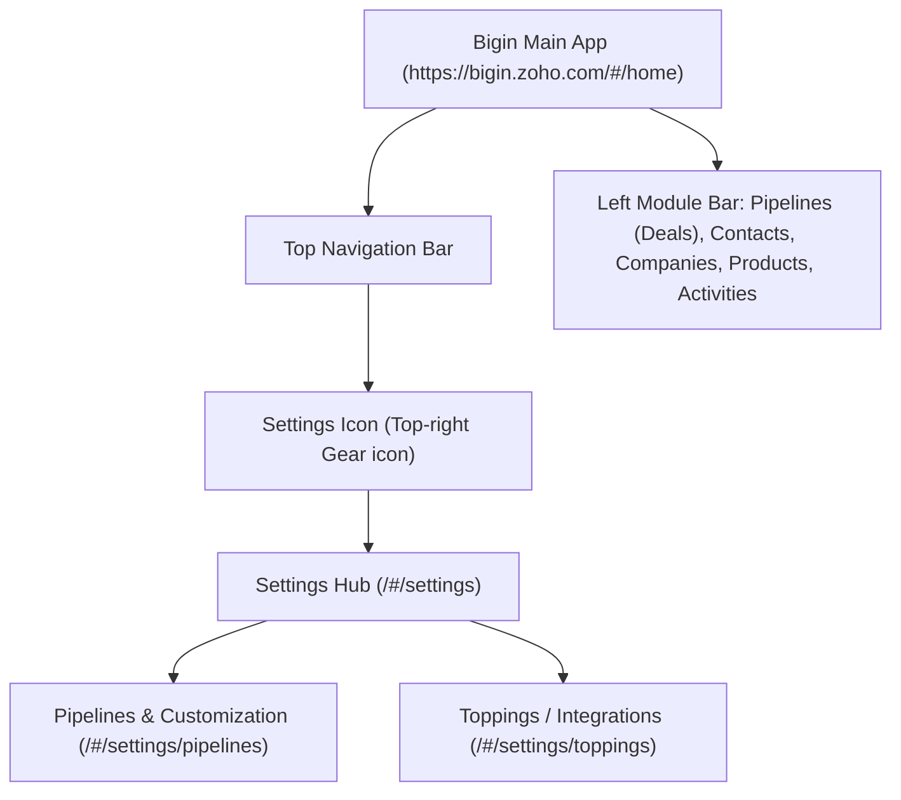

# 🖥️ Zoho Bigin UI Visual Reference & Navigation Guide

This document maps Bigin's User Interface architecture, screen layouts, visual component hierarchies, and interactive controls to assist both AI automated navigation and user manual execution.

---

## 1. Global Navigation Hierarchy



---

## 2. Bigin UI Layout Wireframes

### A. Main Pipelines Kanban View (`/#/pipelines`)

```text
+-----------------------------------------------------------------------------------------------+
| [Zoho Bigin]  Search...                  [+ Add Record]  [Notification] [Settings ⚙️] [Profile] |
+-----------------------------------------------------------------------------------------------+
| [ Modules ] |  [Team Pipeline: Sales Operations ▼]   [Sub-pipeline: Enterprise Deals ▼]       |
|             +---------------------------------------------------------------------------------+
| 📋 Deals    |  QUALIFICATION (3)  |  PROPOSAL SENT (2)  |  NEGOTIATION (1)  |  CLOSED WON (5) |
| 👤 Contacts |  ------------------ |  ------------------ |  ---------------- |  -------------- |
| 🏢 Accounts |  | Acme Cloud      |  | Globex Software |  | Initech Core   |  | Stark Ind    | |
| 📦 Products |  | $15,000         |  | $45,000         |  | $80,000        |  | $120,000     | |
| 📅 Tasks    |  | Contact: Alice  |  | Contact: Bob    |  | Contact: Carol |  | Contact: Tony| |
|             |  +----------------+  +-----------------+  +---------------+  +--------------+ |
+-----------------------------------------------------------------------------------------------+
```

### B. Settings > Pipelines Manager Screen (`/#/settings/pipelines`)

```text
+-----------------------------------------------------------------------------------------------+
| Settings > Pipelines & Stages                                          [+ New Team Pipeline]  |
+-----------------------------------------------------------------------------------------------+
| Active Team Pipelines:                                                                        |
|                                                                                               |
| 1. Sales Operations (Default)    [3 Sub-pipelines]  [12 Stages]        [Edit ✏️] [Manage]     |
| 2. Customer Onboarding           [2 Sub-pipelines]  [8 Stages]         [Edit ✏️] [Manage]     |
| 3. Client Renewals & Upsell      [1 Sub-pipeline]   [5 Stages]         [Edit ✏️] [Manage]     |
|                                                                                               |
| Sub-pipeline Configuration Canvas:                                                            |
| +-------------------------------------------------------------------------------------------+ |
| | [Sub-pipeline: Direct Sales]  [+ Add Sub-pipeline]                                         | |
| |                                                                                           | |
| | Stages Sequence:                                                                          | |
| | [1. Prospecting] ──► [2. Demo Scheduled] ──► [3. Proposal Sent] ──► [4. Closed Won]        | |
| |  Category: Open       Category: Open          Category: Open         Category: Closed Won | |
| |  Prob: 20%            Prob: 40%               Prob: 70%              Prob: 100%           | |
| |                                                                                           | |
| | [+ Add Stage]                                                    [Cancel]  [Save Changes] | |
| +-------------------------------------------------------------------------------------------+ |
+-----------------------------------------------------------------------------------------------+
```

### C. Stage Configuration Modal / Flyout

```text
+-----------------------------------------------------------+
| Configure Stage Properties                                |
+-----------------------------------------------------------+
| Stage Name:          [ Proposal Sent                    ] |
|                                                           |
| Stage Category:      (o) Open                             |
|                      ( ) Closed Won (100% Probability)    |
|                      ( ) Closed Lost (0% Probability)     |
|                                                           |
| Probability (%):     [ 70 % ]                             |
|                                                           |
| Mandatory Fields on Stage Entry:                          |
| [x] Quote_Amount                                          |
| [x] Decision_Maker_Contact                                |
| [ ] Expected_Close_Date                                   |
|                                                           |
| Stage Description:   [ Proposal delivered to client     ] |
|                                                           |
|                                      [Cancel]   [Apply]   |
+-----------------------------------------------------------+
```

---

## 3. Step-by-Step UI Navigation Paths for Users

If a user prefers manual clicks or wants to verify an agent-configured setup, provide these exact click paths:

* **Path to create a Team Pipeline**:
  `Settings (Gear icon at top-right)` $\rightarrow$ Under *Customization*, click `Pipelines` $\rightarrow$ Click blue button `New Team Pipeline` (top-right) $\rightarrow$ Enter Pipeline Name $\rightarrow$ Select Access Roles $\rightarrow$ Click `Save`.
* **Path to add or edit Stages**:
  `Settings` $\rightarrow$ `Pipelines` $\rightarrow$ Click on the target Team Pipeline $\rightarrow$ Select the Sub-pipeline tab $\rightarrow$ Click `+ Add Stage` $\rightarrow$ Set Name, Category (`Open`, `Won`, or `Lost`), and Probability % $\rightarrow$ Click `Save`.
* **Path to configure Zoho Books integration**:
  `Settings` $\rightarrow$ Under *Integrations*, click `Toppings` $\rightarrow$ Select `Zoho Books / Invoice` $\rightarrow$ Click `Setup Now` $\rightarrow$ Choose your Zoho Books Organization $\rightarrow$ Map Customer and Item fields $\rightarrow$ Click `Save`.
* **Path to configure WhatsApp Topping**:
  `Settings` $\rightarrow$ `Toppings` $\rightarrow$ Select `WhatsApp` $\rightarrow$ Click `Connect` $\rightarrow$ Authenticate your Meta Business Manager / WABA phone number $\rightarrow$ Sync approved message templates.
