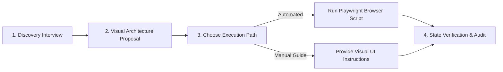

# 🤝 Workflow: Interactive Guided Pipeline & Flow Builder

This runbook instructs the AI agent on how to interview the user, architect the business process, generate visual diagrams, and provide both automated execution and step-by-step manual instructions.

---

## 1. The 4-Stage Interactive Consultation Model

When a user says *"Help me build a pipeline"* or *"Set up an automated sales flow"*, the agent operates in consultation mode:



---

## 2. Stage 1: Discovery Interview Checklist

The agent must prompt the user with clear, structured questions:
1. **Pipeline Objective**: What operational cycle does this pipeline represent? *(e.g., Inbound Sales, Customer Onboarding, Support Tickets, Procurement)*.
2. **Sub-pipelines**: Do you need separate tracks? *(e.g., Enterprise vs. Self-Serve, Domestic vs. International)*.
3. **Stage Sequences & Milestones**: What are the 4–8 progressive steps a deal moves through from start to finish?
4. **Win/Loss Criteria**: When is a deal considered won (100% finished) vs. lost (disqualified)?
5. **Connected Services**: Does this pipeline trigger invoices in **Zoho Books**, notifications on **WhatsApp**, or task allocations in **Zoho People**?

---

## 3. Stage 2: Presenting the Architecture & Visual Wireframe

Once the user provides their goals, the agent must render:

1. **A Mermaid Flow Diagram** representing the stages, probabilities, and transition gates.
2. **The JSON Specification** conforming to [`pipeline_validator.py`](../scripts/configuration-tools/pipeline_validator.py).
3. **The Subscription Impact** (verifying that the user's plan tier supports the pipeline/stage count).

---

## 4. Stage 3: Dual Execution Paths (Automate vs. Guide)

The agent must offer the user their preferred mode:

### Option A: Fully Automated Browser Execution
- The agent runs the verified Playwright script:
  ```bash
  python browser-automation/verified-procedures/pipeline_manager.py --action create_pipeline --config proposed_spec.json
  ```
- Captures screenshots at each step and provides proof of creation.

### Option B: Step-by-Step Guided UI Walkthrough
- For users who prefer to click through themselves, the agent provides rich, numbered instructions with exact UI labels:
  ```markdown
  ### Manual Step-by-Step Instructions:
  1. Go to **Settings** (Gear icon ⚙️ in the top-right corner).
  2. Under the **Customization** header, click **Pipelines**.
  3. Click the blue **+ New Team Pipeline** button in the upper-right corner.
  4. Enter the Name: `Customer Onboarding`.
  5. In the Sub-pipeline section, click `+ Add Stage` and enter:
     - Stage 1: `Kickoff Scheduled` (Category: Open, Probability: 20%)
     - Stage 2: `Technical Provisioning` (Category: Open, Probability: 50%)
     - Stage 3: `Client Sign-off` (Category: Open, Probability: 80%)
     - Stage 4: `Live in Production` (Category: Closed Won, Probability: 100%)
  6. Click the blue **Save** button at the bottom.
  ```

---

## 5. Stage 4: Post-Creation Verification
- Check DOM / API to confirm that the new pipeline appears in the Bigin module dropdown.
- Provide a test checklist for the user to create their first deal card.
